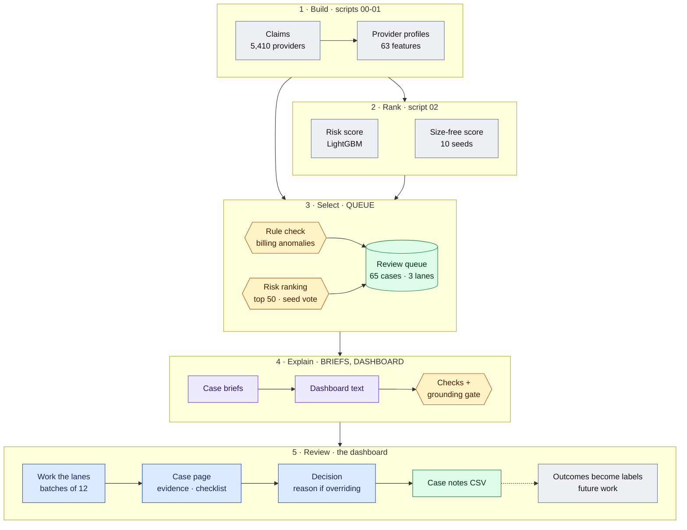
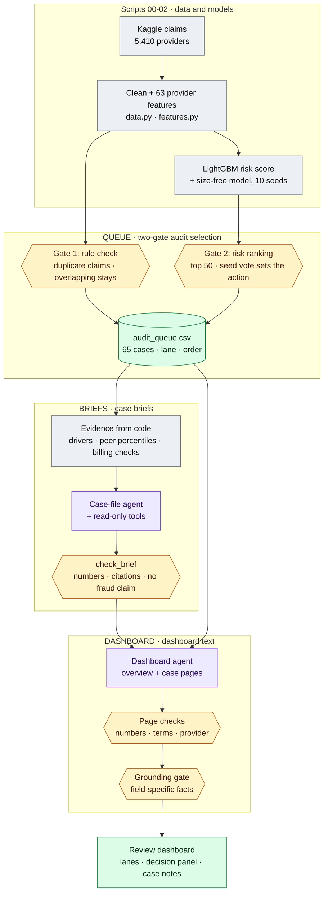
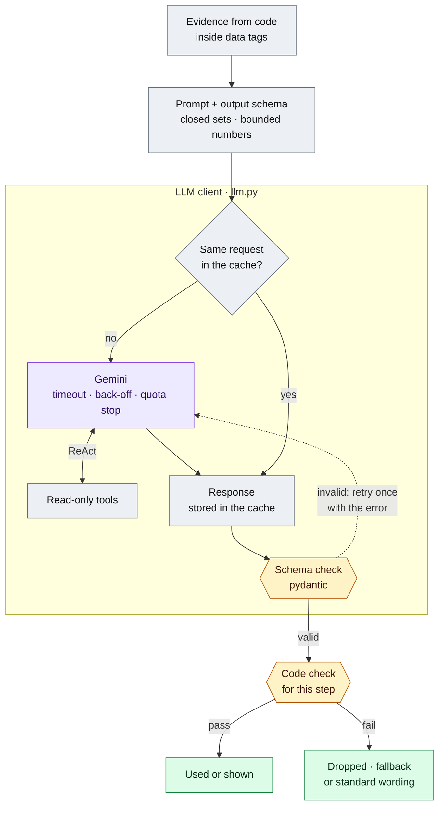

# Medicare Provider Fraud Risk Ranking, LLM-Assisted Investigation and Case Review Dashboard

**BT4012 Fraud Analytics · Group 20**

| Name | Student ID |
|---|---|
| Isabella Tan Jing Xuan | A0282806Y |
| Isaac Lim Zhongyu | A0272258Y |
| Charmaine Neo Jia En | A0281655X |

## Description

Limited audit capacity makes it difficult to prioritise suspicious Medicare providers while distinguishing
unusual billing from high billing volume. This project combines fraud risk ranking, billing checks, and
LLM-assisted investigation in a case review dashboard to help reviewers assess evidence and record audit decisions.

## How it works

The workflow runs in five phases, from claims to an investigator's decision. Step names are the
commands that run each part (`scripts/02_run_experiments.py STEP`, `scripts/03_run_agents.py STEP`).



| Grey | Purple | Amber | Blue | Green |
|---|---|---|---|---|
| Decision logic | LLM agent | Validation check | Investigator | Output |

Two sets of experiments evaluate the system alongside this workflow:

- **Agent evaluation:** `CLEAN`, `LEAK_AGENT` and `AGENT_MODEL` test agent performance independently of the review queue.
- **Ranking evaluation:** Model experiments assess predictive performance, signal beyond provider size, data leakage, class imbalance, robustness, fairness and audit capacity.

| Stage | What happens | Who decides |
|---|---|---|
| **Clean + features** (`01`) | Recode flags, parse dates, drop constants, count (never impute) missing fields; aggregate claims into 63 provider features in 8 families; freeze a stratified 80/20 provider split and 5×5 CV folds | Code (`data.py`, `features.py`) |
| **Statistics** (`02 EDA_TESTS`) | Chi-square, Mann-Whitney and Welch tests, skew and kurtosis, Benford's law, boxplot and z-score outlier rules | Code |
| **Models** (`02`) | Size-only baselines, expert rules, logistic regression, random forest, LightGBM, feedforward network, autoencoder, Isolation Forest, network features; tuning on CV repeat 1; the test set is scored once | Code |
| **Stress tests** (`02 EVASION, FAIRNESS`) | Black-box evasion (provider splitting, blend-in) with adversarial training; false-positive rates by provider group; calibration | Code |
| **Review queue** (`03 QUEUE`) | Two-gate audit selection (below) | Code |
| **Case briefs** (`03 BRIEFS`) | One brief per queued provider: drivers, billing findings, playbook citations, uncertainty, using lookup tools | LLM writes; code checks every number and citation, and that the strongest drivers and any billing finding are named |
| **Dashboard** (`03 DASHBOARD`) | Plain-language overview and provider pages for full-audit and borderline cases | LLM writes; code checks, then a final grounding gate |

### Two-gate audit selection

* **Gate 1 – rule check.** Billing anomalies that need verification goes straight to review: any claim that
  repeats an earlier one (same patient, date, amount, main diagnosis), or two or more inpatient stays
  that start before the same patient's earlier stay ended. A single overlap is shown as a warning only.
* **Gate 2 – risk ranking.** The 50 highest-scoring remaining providers (LightGBM) join the queue.
  The size-free model is retrained with 10 seeds: **full audit** if ≥8 of 10 put the provider in
  their size-free top 50, **borderline** desk review at 3–7, otherwise **desk review**.
* **Order.** The rule decides *whether* a provider is reviewed; the model decides *when*: the queue is
  sorted by risk score, then provider ID, so it is identical on every rebuild.

All thresholds are in `src/fraudrank/config.py` and were set on development providers only.

### Review dashboard

`results/dashboard/provider_review_dashboard.html` – the refreshed, self-contained dashboard,
built from the existing caches and usable offline.

Open the HTML file in your browser by double-clicking it, or run this from the project root on macOS:

```bash
open results/dashboard/provider_review_dashboard.html
```

No server or internet connection is required.

For the refreshed dashboard built without API calls, see **Offline fixes and rebuild** below.

* **Today's work:** progress, the next case, and the review queue with lane tabs (full audit,
  borderline, desk review), grouping (reason, pattern, type of care, batch) and **batches of 12**.
  Each row shows one line of evidence, facts only, e.g. `1 duplicate claim · 2 overlapping hospital stays · $3.21M paid`.
* **Case page**, in working order: why it's here (reason and evidence), what to check (a checklist),
  then details on request (comparisons, matching fraud patterns, all measures). Rule-check pages list
  the claims behind the referral as one-line summaries written by code (e.g. `$14,030 billed twice for
  BENE25655 on 2009-08-18 … end dates differ by 2 days`). Desk reviews get a lighter page in standard wording.
* **Decision panel:** open full audit, desk review or no further action; a reason is required when
  differing from the recommendation; *Save & next case* moves on. Keys: 1-3 choose, S save, J/K move.
* **Export all case records:** each case's decision, reason, checklist progress and note as CSV. Decisions
  and notes stay in the browser until downloaded.
* **All providers:** look up any of the 1,082 providers (search, table or cards).
* **Ranking insights:** this cycle at a glance, why cases are here, what investigators will find in
  the records, and the size-or-behaviour map.
* **Decisions:** saved outcomes, newest first, with filters for full audit opened, desk review and
  no further action. Each row shows the original recommendation, decision, reason and local date/time.
  Open the case to change its decision, or use **Export saved decisions** to export the selected status as CSV (timestamps in UTC).
  The review queue tabs show recommendation totals; "Decisions recorded" tracks progress separately.
* **How it works:** a help panel from the **?** icon or key, with ⓘ links next to key terms.
* **Grounding gate:** queue evidence is re-derived from structured case data. Factual AI wording
  must match code-owned wording for the specific field, including units and comparisons; otherwise
  the page uses standard wording. Qualitative review instructions can be reused, and a small sample
  size such as "Sample two claims" is treated as an instruction. A number appearing elsewhere in
  the evidence is not sufficient support (`agents/dashboard_grounding.csv`).
* **Saved work:** decisions, notes and checklist ticks are scoped to the dataset and review cycle.
  A failed save keeps the form open and displays an error. Export notes from an older dashboard
  before switching to a rebuilt cycle; they are not automatically carried into the new cycle.

## Agent harness: design and architecture

The agent layer (`src/fraudrank/agents/`, run by `scripts/03_run_agents.py`) is built around one rule:
**agents propose and explain; code decides and checks.**

### Design principles

| Principle | How it is enforced | Why |
|---|---|---|
| Code makes every decision | Who is reviewed, each action, and the model chosen in AGENT_MODEL are set by code (`audit_selection.py`, `selection.py`). Agents only propose, critique and explain | LLM outputs vary between runs, and a decision that affects a provider must be repeatable and explainable. BRIEFS shows why: with retrieval, the agent's own suggested action matches the rules in 78% of briefs, but it escalates 9 of 12 desk-review cases by re-arguing size, which the queue has already discounted. Its suggestion is recorded for evaluation and never shown to investigators |
| Closed outputs | Every agent returns JSON that matches a schema (`schemas.py`): closed sets of options and bounded numbers, validated with pydantic | An agent can only ask for actions the code knows how to run safely. No free text is executed |
| Agents never see raw data or labels | Agents receive summaries and specifications; the executor (`executor.py`) computes features and runs models | No label leakage, no patient-level data in prompts, and results that do not depend on the model reading data correctly |
| Read-only tools, least privilege | Tools look things up and return facts; no tool writes or changes anything (`tools.py`) | A tool call cannot alter the data, the queue or another agent's output |
| Every output is checked before use | Each step has its own code check; failing output is dropped and replaced with standard wording or a fallback, never shown unchecked | What reaches an investigator must trace to the evidence |
| Untrusted text is evidence, not instructions | Data goes inside `<data>` tags, and every prompt says text in them is to be analysed, never followed | A defence against prompt injection from claim text or retrieved documents |
| Reproducible by design | Every response is cached and replays without a key; each experiment runs 3 times; the model version is logged | Sampling cannot be fixed on current models, so the cache is the record of what each agent said |

### Architecture

Colours: **grey** = code that decides, **purple** = LLM agent (proposes or explains), **amber** = code check,
**green** = output.

**1. System overview.** Everything that decides who is reviewed, and how, is code. LLM agents only
write explanations, and each one is checked before it is shown.



The agent experiments run alongside and do not feed the queue:
**CLEAN** (cleaning plan, scored against `data.py`), **LEAK_AGENT** (leak benchmark) and **AGENT_MODEL** (diagram 3).

**2. One agent step.** Every LLM call goes through the same harness (`llm.py`), and every result
goes through a code check before it is used.



**3. AGENT_MODEL loop.** Agents propose; code computes, filters and chooses.

```mermaid
flowchart LR
    classDef code fill:#eceff3,stroke:#6b7280,color:#111
    classDef llm fill:#ede9fe,stroke:#7c3aed,color:#2e1065
    classDef gate fill:#fef3c7,stroke:#b45309,color:#451a03
    classDef out fill:#dcfce7,stroke:#15803d,color:#052e16

    F["Feature agent<br/>proposes features"]:::llm --> X["Executor<br/>computes them from claims"]:::code
    X --> K["Leakage agent<br/>screens them"]:::llm
    K --> E["Experiment agent<br/>3-4 configurations"]:::llm
    E --> G{{"Preview gate<br/>3 folds"}}:::gate
    G --> C["Cross-validation<br/>CV repeat 1"]:::code
    C --> S{{"Paired-fold rule<br/>chooses the model"}}:::gate
    S --> R["Critic<br/>stop or next round"]:::llm
    R -->|"next round<br/>max 3"| E
    R -->|stop| V["Evaluate once<br/>unseen CV repeats 2-5 + test"]:::out
```



**Shared LLM client (`llm.py`)**, used by every agent:

| Feature | What it does | Why |
|---|---|---|
| Structured output | Output is constrained to a JSON schema (Gemini `response_json_schema`), then validated with pydantic. On a validation error the call is retried once with the error appended; a second failure raises an error. If Gemini cannot serve every bound of a schema at once ("too many states"), the call is sent with the bounds removed and pydantic enforces them | Malformed output is never silently dropped or half-used |
| Response cache | Every response is stored, keyed by a SHA-256 hash of the full request (model, system prompt, messages, schema or tools, effort). `--replay` runs every step from the cache with no API key | Exact reproduction of agent results, and free re-runs of steps whose inputs did not change |
| Resilience | 3-minute timeout per request; up to 7 attempts with back-off (10 to 120 s) on rate limits, server errors and dropped connections. A used-up **daily** quota stops the step at once, before it writes anything | Free-tier overload is common; a step that runs out of quota must not overwrite good results with partial ones |
| Effort | Low by default; high for judgement tasks (cleaning plan, critic, case briefs) | Spend thinking where the task needs judgement, not on formatting |
| ReAct loop | The model calls tools until it is done (at most 3 turns for the critic, 6 for case briefs), then one final structured call turns the investigation trace into schema-checked output. If the turn budget runs out, it answers from the tool results gathered so far; this is counted (`tool_budget_reached`), and in AGENT_MODEL also listed in `agent_model_failures.json` as a completed run. Every turn is cached | Tools let an agent verify facts before it writes, and the final output still goes through the same schema and checks |
| Provenance | The exact model version that answered is stored with each response and in `llm_usage.json`, with call and token counts | Model aliases move over time; the log shows what produced each result |

### Steps: what each does and why

Steps run in this order (`run_agents_local.py`), and each can be re-run on its own:
`RETRIEVAL → CLEAN → LEAK_AGENT → AGENT_MODEL → QUEUE → BRIEFS → DASHBOARD`.

**RETRIEVAL** (no LLM). Hybrid search over the ten-section fraud-typology playbook: BM25 for exact
terms plus a dense latent-semantic index, fused by reciprocal rank. It is scored on 20 labelled queries
written with different words from the playbook.
*Why:* case briefs cite the playbook, so retrieval quality is measured on its own, before any generation.

**CLEAN: can an LLM reproduce the analyst's cleaning decisions?**
* The cleaning agent proposes a plan for each raw file (4 calls), with a general checklist (yes/no
  flags not coded 0/1, constant columns, dates stored as text, values missing because they do not apply).
* Code requires exactly one step for every column; it asks once more for any column left out, and
  drops steps for columns that do not exist.
* The plan is scored against the 7 decisions in our own `data.py`. **It is not executed**: the
  pipeline always uses `data.py`.
* *Why:* a single call asked for "columns that need action" covered only the easy ones (2 of 7).
  Enforcing coverage in code, not in the prompt, raised it to 6.3 of 7.

**LEAK_AGENT: does the leakage agent catch leaks?** The agent reviews 15 feature specifications, 5 of them
with planted leaks (label, test-set or after-the-fact information), and code scores catches and
false alarms.
*Why:* AGENT_MODEL relies on this agent to screen features, so it is tested against known answers first.

**AGENT_MODEL: can agents build a model as good as the hand-tuned pipeline?** One loop, repeated 3 times:
1. **Feature agent** proposes new features from a closed grammar (a claim column × an aggregate ×
   inpatient/outpatient/all, or a ratio of provider totals). The executor computes them from the
   claims; the agent never sees the data. In the "with definitions" rows it is also given every
   existing feature's definition in the same grammar (`feature_brief.py`), and a **duplicate gate**
   (code) drops proposals that only re-express an existing feature.
2. **Leakage agent** screens them; rejected features are removed.
3. **Experiment agent** proposes 3–4 configurations (model, feature set, imbalance handling, bounded
   settings), from a trimmed context: feature-set sizes, model options and past results only.
4. **Preview gate** (code) scores each proposal on 3 folds and drops any whose mean plus one standard
   deviation is below the best seen so far on those same 3 folds; at least one always survives.
5. **Cross-validation** on the first CV repeat, then **code chooses** with a paired-fold rule
   (`selection.py`): the best-scoring configuration wins only if it beats a simpler one by more than
   one correlation-corrected paired standard error *and* on most folds; otherwise the simpler one is kept.
6. **Critic** (ReAct, with a tool that returns per-fold scores) sees the code's choice and decides
   whether to stop, which experiments to run next (up to 3 rounds), and what looks wrong.
7. **Evaluation** on CV repeats 2–5 and once on the test set; later repeats reuse the same development
   providers, so they are descriptive comparisons rather than independent nested evaluation. Ablations
   (round 1 only without the critic, no feature agent, no leakage review) are repeated for every run.

Three designs are compared, 3 runs each: three agents without definitions (the original loop), three
agents with definitions, and **one agent with definitions**, a single modelling agent that proposes
features and configurations together. A **fold test** fixed in advance (`selection.py`) decides whether
the separate roles earn their place: keep them only if the 95% CI of the per-fold difference (one agent
minus three, each fold averaged over runs) lies entirely below 0 (`agent_model_fold_test.json`).
The offline correction uses a Nadeau–Bengio variance correction for overlapping training folds:
`SE = sqrt((1 / n_folds + n_validation / n_training) * variance_of_differences)`.
This widens the interval; it does not remove selection bias or establish equivalence.

*Why this design:*
* In the first version, the critic chose the model using a "beat it by one standard deviation" rule
  and picked weaker models; comparing models fold by fold is the right yardstick, and code applies it
  exactly.
* An earlier experiment agent was told to drop weak proposals and did not; the preview gate does it in code.
* Repeats 2–5 change fold assignments, but do not provide new providers unseen during selection.

**QUEUE** (no LLM). Two-gate audit selection: the rule check, the risk ranking and the 10-seed model
vote (see above). Written to `audit_queue.csv` before any later agent runs; BRIEFS and DASHBOARD stop if it is missing.
*Why:* who gets audited, and how, must not depend on an LLM.

**BRIEFS: case briefs.** One brief per queued provider, with and without playbook retrieval (130 briefs).
* Evidence comes from code: the five strongest model drivers with values and peer percentiles, the
  billing-check counts, why the provider is queued, and for rule-check referrals the one-line billing
  exhibits. The seed votes and the code's action are not shown, so the agent's suggested action is its own reading.
* The case-file agent can call `lookup_provider`, `get_peer_stats` and `search_playbook` before it writes.
* A **completeness check** (code) requires the three strongest drivers and, for rule-check referrals,
  the billing finding in the summary; a brief that misses them gets one revision, then code fills the gaps.
* `check_brief` (code) checks every brief: driver values, percentiles and model contributions match the
  evidence; every cited playbook section was actually retrieved and lists one of the brief's drivers;
  the provider and rank are right; and there is no claim that fraud is proven (negation-aware).
  A failed brief is excluded from downstream evidence rather than merely recorded as a failure.
* The agent's suggested action is recorded next to the code's decision, but decides nothing and is not
  shown on the dashboard.
* The trajectory is logged (`briefs_trajectory.json`): which tools were called, on which provider, with what result.
  In practice the agent used tools in only 2 of 65 briefs, because nearly every number it needed was already in its prompt.
* *Why:* tools let the agent verify before writing; code checks make faithfulness measurable; the
  no-retrieval condition shows what retrieval adds.

**DASHBOARD: dashboard text.** One overview and one page per full-audit or borderline case; desk reviews
get standard wording. Run 3 times; the dashboard is built from run 1.
* Evidence is formatted exactly as the page shows it (the page's rounding is mirrored in Python),
  and each text field has a word limit set by its space on the page.
* Code checks (`dashboard_agent.py`): every number must appear in the evidence, no technical terms, no
  claim that fraud is proven, the right provider, only known factors and patterns, and all required
  cautions on the overview.
* A page that fails is replaced by standard wording; text that only runs over its word limit is
  dropped in that one place.
* A final **grounding gate** (`grounding.py`) binds factual wording to specific evidence fields.
  Cached factual prose that cannot be verified is replaced by code-written text; safe qualitative
  checklist instructions are retained. Currency scales, counts and feature values cannot be
  transferred between fields just because their digits appear somewhere in the evidence.
* *Why:* investigators act on this text, so every statement must trace to the case. Checking item by
  item means one bad sentence does not take a whole page down.

**Checks and tests.** `tests/test_agent_plumbing.py` runs every agent code path with a fake LLM
(nothing written to `results/`), including the selection rules, the queue rebuild, and the grounding
gate's handling of invented numbers, jargon and numbers written in words.

## Results

Data: 5,410 providers, 9.35% previously flagged. The label means *previously suspected*, not proven
fraud. Test set: 1,082 providers, 101 flagged.

**Ranking** (PR-AUC; CV = 25 folds on development data, test = held-out 20%, 95% bootstrap CI)

| Model | CV | Test |
|---|---|---|
| Total payments alone (no model) | 0.674 | 0.743 [0.670, 0.815] |
| Expert rules | 0.390 | 0.404 |
| Logistic regression | 0.699 | 0.775 |
| Random forest | 0.708 | 0.782 |
| **LightGBM** | **0.732** | **0.805** [0.740, 0.867] |
| LightGBM, no size features | 0.714 | 0.784 [0.716, 0.853] |
| Feedforward neural network | 0.677 | 0.785 [0.722, 0.848] |
| Autoencoder (trained on non-flagged) | 0.140 | 0.088 [0.080, 0.101] |

* A model beats provider size alone, and still does without any size features.
* Hospital-stay intensity is the strongest behaviour signal: dropping it from the size-free model costs 0.087 PR-AUC.
* Network features add nothing (+0.001); the naive homophily test is confounded by degree.
* With 30% of flags hidden, PR-AUC falls gracefully to 0.686; a leaky claim-level split inflates results.
* LightGBM on test: 86% of the top 50 and 74% of the top 100 were previously flagged.
* Deep models do not beat boosting: the feedforward network is level with size alone in CV (LightGBM is better on
  25 of 25 folds), and the autoencoder's most anomalous providers have a median of one claim (unusual, not suspicious).
* Statistics: flag and type of care are dependent (chi-square 607, Cramér's V 0.33); Benford's law gives no signal
  (flagged and other providers deviate equally, MAD 0.0176 vs 0.0175).
* Evasion (test PR-AUC): splitting each flagged provider into two IDs, simulated on its claims, cuts size alone
  0.743 → 0.573, LightGBM 0.805 → 0.682 and the size-free model 0.784 → 0.679; cutting stay lengths cuts the
  size-free model to 0.408. Adversarial training on copies with halved size counts defends against that shortcut
  attack (0.825) but not the split rebuilt from claims (0.664) or blend-in (0.448).
* Within size bands (the two largest fifths by payment, out-of-fold CV), the size-free model reaches 0.734 against
  0.687 for size alone, so a margin remains once size is roughly held fixed.
* Fairness: in the cost-optimal queue, honest providers that bill inpatient care are queued by mistake at 22.8%
  against 2.6% for outpatient-only ones; dropping patient-mix features narrows the patient-acuity gap at no cost.

**Review queue** (test set)

| | Providers | Previously flagged |
|---|---|---|
| Gate 1 rule check | 15 (7 duplicate claims, 10 overlapping stays; 2 trigger both) | 12 |
| Gate 2 risk ranking | 50 → 38 full audit, 4 borderline, 8 desk review | 41 |
| **Queue** | **65** | **53** |

On development data, the gate-1 rules refer 59 providers, 81% of them flagged (base rate 9%). In 30 of the 33
duplicate pairs, only the end dates differ (by 1–3 days), so the duplicate rule's precision may partly reflect
how the claims were generated.

**Agents** (Gemini 3.5 Flash-Lite, 3 runs each)

| Experiment | Result |
|---|---|
| CLEAN | 6.3 of 7 reference decisions on average (6, 6, 7); 84 of 84 columns covered. The original one-call prompt caught 2 of 7 |
| LEAK_AGENT | 5/5 planted leaks caught, 0 false alarms, in every run |
| AGENT_MODEL vs fixed | CV 0.724 vs 0.730 (range 0.723–0.725); test 0.802 vs 0.805, difference −0.003 [−0.021, +0.014]. Agents match, but do not beat, the hand-tuned pipeline; the feature agent adds nothing |
| Feature definitions | Redundant proposals fall from 53% (24 of 45) to 19% (6 of 31); CV 0.728, but only one run of three used agent features, and no run beats the fixed pipeline significantly on test |
| One agent vs three | One agent with definitions: CV 0.721. Offline correlation-corrected fold comparison: one minus three −0.007 [−0.018, +0.004]. The interval crosses zero, so the stated simplicity rule favours one agent; equivalence is not established. Original agent configurations and predictions are retained. One agent used 27 calls against 37 |
| BRIEFS | 130 briefs: 597/597 driver values exact, 164/164 citations real and on point, 0 claims of proven fraud, every brief complete on its first attempt. With retrieval, the suggested action matches the code's decision in 78% of briefs (74% without); of 14 disagreements, 9 escalate desk reviews on size and 5 question single-duplicate referrals. Trajectory: 6 tool calls in 2 of 65 briefs |
| DASHBOARD | Overview passed in 3/3 runs; provider pages 55, 57, 55 of 57 (failures: an exact figure quoted from outside the page's evidence, or an unstated stay length, caught) |
| Grounding gate (original run) | 162/162 evidence items re-derived; 31 of 983 AI items removed by the original numeric check. This did not establish semantic faithfulness; refreshed field-specific checks are in `results/dashboard/tables/agents/dashboard_grounding.csv` |

## Offline fixes and rebuild

With the existing data and caches on this machine, refresh statistics, billing evidence, the queue
and dashboard **without retraining predictive models or making any API calls**:

```bash
source .venv/bin/activate
python scripts/rebuild_offline.py
open results/dashboard/provider_review_dashboard.html  # macOS
```

The script blocks network access and fails if required caches are missing. It reads saved predictions,
seed scores, fold results and agent responses. Changed case evidence uses standard dashboard text;
it never asks an agent to rewrite it. Outputs go to `results/dashboard/`, preserving the original tables
and locally modified agent results. Refreshed tables are in `results/dashboard/tables/`;
`results/dashboard/manifest.json` records input/output SHA-256 hashes, cache
compatibility checks, changed queue providers and any statistics that could not be refreshed.

The rebuild also recalculates EDA using development providers only. That prevents future exploration
from reading held-out labels, but cannot undo earlier exposure to full-dataset summaries.
SMOTE, patient-mix features and nested CV are deferred. Existing model selections and fitted predictions
remain the historical experiment results; the corrected selection rule applies to future searches.
Some deep-model and agent test prediction caches are absent, so their original test intervals cannot
be recalculated without additional model work. The manifest identifies these limits. The project report
now incorporates the corrected interpretation and distinguishes refreshed statistics from historical model results.

Local regression checks:

```bash
python tests/test_offline_fixes.py
node tests/test_dashboard_storage.cjs
node tests/test_dashboard_decisions.cjs
python tests/test_agent_plumbing.py
```

The first three checks use small fixtures. The plumbing check uses existing processed data, a fake LLM,
and a few small model fits; it does not call the API or replace experiment artifacts.
| Retrieval | Hybrid search recall@1 0.90 (BM25 0.85, dense 0.80) on 20 test queries |

## Reproducing the results

**1. Environment** (Python 3.12+; tested on 3.12 and 3.13)

```bash
python3 -m venv .venv && source .venv/bin/activate     # Windows: .venv\Scripts\activate
pip install -r requirements.txt
```

On macOS, LightGBM needs OpenMP: `brew install libomp`.

**2. Data** (not redistributed; downloads from Kaggle and checks file sizes)

```bash
python scripts/00_get_data.py
```

**3. Models** (~20 min on 2 cores)

```bash
python scripts/01_build_features.py
python scripts/02_run_experiments.py          # EDA_TESTS, TUNE, SIZE, MODELS, FAMILIES, NETWORK, IMBALANCE, NOISE,
                                              # TEST, DEEP, EVASION, FAIRNESS, SIZE_BANDS, LEAKY_SPLIT, SUMMARY
python scripts/04_make_figures.py
```

**4. Agents, queue and dashboard**

```bash
cp .env.example .env                          # paste your key after GEMINI_API_KEY=
python scripts/run_agents_local.py            # RETRIEVAL, CLEAN, LEAK_AGENT, AGENT_MODEL, QUEUE, BRIEFS, DASHBOARD
```

For a historical workflow whose requests still match the cache, replay mode uses no key or API calls
(it still runs local model experiments):

```bash
python scripts/03_run_agents.py --replay
```

For the fixes above, prefer `python scripts/rebuild_offline.py`: changed checks, selection decisions
or prompts can cause replay cache misses. Do not switch to live mode to refresh the dashboard.

Notes:

* About 520 LLM calls for a full run (517 in ours), more than the free tier's 500 requests a day, so a full run
  spans two days. If the daily quota runs out, the step stops without writing partial results – run the same
  command after the reset and the cache carries on where it stopped. Gemini also returns "high demand" (503)
  errors at busy times; each call retries up to 7 times, and a run that still fails is recorded, so re-running
  the same command later completes it.
* Offline check of all agent code paths (fake LLM, nothing written): `python tests/test_agent_plumbing.py`.
* The original experiment revision was replay-verified on macOS with Python 3.12
  (0 API calls, every table and the dashboard identical). That historical verification does not cover
  the later code fixes. On another platform, scripts
  00–02 reproduce every table exactly except last-digit floating-point noise (for example 0.69559 vs 0.69564 in a
  tuning grid). AGENT_MODEL embeds those scores in its prompts, so on Windows its cache keys can miss: with
  `--replay` it then stops with an error instead of calling the API. RETRIEVAL, CLEAN, LEAK_AGENT, QUEUE, BRIEFS
  and DASHBOARD replay identically at the original experiment revision.

## Repository layout

```
src/fraudrank/
  data.py, features.py, splits.py      cleaning, 63 features, frozen split and folds
  models.py, network.py, metrics.py    models, provider network, PR-AUC / precision@k / CIs
  audit_selection.py                   two-gate audit selection
  config.py                            seeds, split, queue settings
  agents/                              LLM client, agents, schemas, tools, retrieval,
                                       checks, grounding gate, dashboard
scripts/                               00 data · 01 features · 02 models · 03 agents · 04 figures
tests/test_agent_plumbing.py           offline checks with a fake LLM
results/tables/                        every number above (agents/ for the agent layer)
results/dashboard/                     the review dashboard
results/cache/llm/                     cached LLM responses
report/                                report20.docx (editable), report20.pdf
```

## Limitations

* The claims appear to come from CMS's synthetic DE-SynPUF files, and how `PotentialFraud` was
  assigned is undocumented: results describe this benchmark, not real providers.
* The test set has 101 flagged providers, so close models are not separable at one queue size.
* LLM outputs vary between runs; every agent experiment is run three times and the spread reported.
